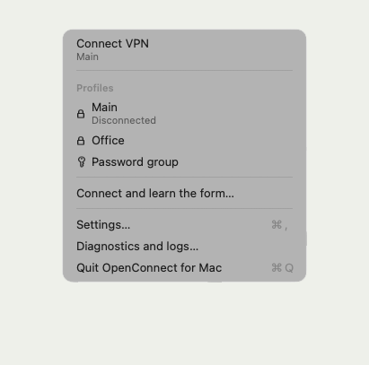
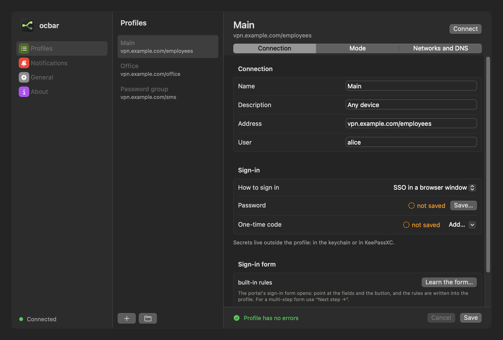
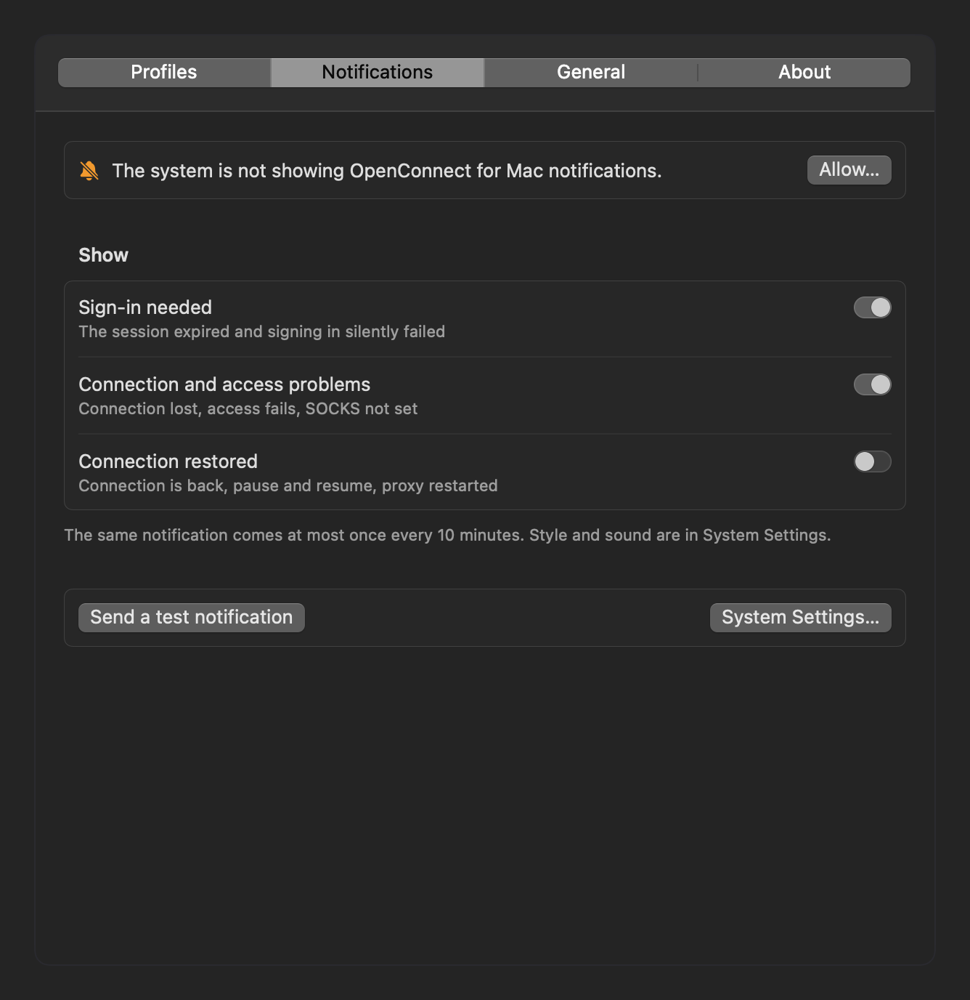

# ocbar

[Website](https://valeragin.github.io/ocbar/)

**English** · [Русский](README.ru.md)

**Your work VPN, in your Mac’s menu bar.**

An open-source, Cisco AnyConnect–compatible client built on
[OpenConnect](https://www.infradead.org/openconnect/). Sign in with SSO,
choose which networks go through the tunnel, and pause or resume from a
native macOS menu. The supervisor reconnects after sleep and network changes.

Free under the MIT license. Install through Homebrew, which builds the app
on your Mac. Requires macOS 13+ and access to your own compatible VPN gateway;
ocbar does not provide VPN servers.



<sub>The real menu on a demo profile: connect, switch off a network, pause.</sub>

**Status:** a single-author tool used daily on a real AnyConnect gateway
with a Keycloak identity provider. The app, the sign-in windows and the CLI
follow the system language (English or Russian); the longer guides,
[INSTALL.md](INSTALL.md) and [TROUBLESHOOTING.md](TROUBLESHOOTING.md), are in
Russian. Version history is in [CHANGELOG.md](CHANGELOG.md).

> Not affiliated with Cisco. "AnyConnect" is used only to describe protocol
> compatibility.

## Why

OpenConnect speaks the AnyConnect protocol, but on macOS the gaps are
everything around it: gateways that only allow SAML login, a
`vpnc-script` that routes all traffic and rewrites DNS, no reconnect after
sleep, and no menu bar UI. ocbar fills those gaps without a kernel extension,
a root daemon, or an Apple Developer ID.

## How it works

```
ocbar connect
  │
  ├─ ocbar-auth (Swift, WKWebView)        runs as the user
  │    init → SAML window → cookie → auth-reply → session token + server cert hash
  │
  └─ sudo -n ocbar-helper tunnel-start    root, the only NOPASSWD entry
       ├─ openconnect --cookie-on-stdin --script "ocbar-helper vpnc" -b
       └─ vpnc: ifconfig utunN, our routes, our /etc/resolver zones — nothing else

ocbar supervise (LaunchAgent)             runs as the user, every 5 s
       tunnel pid · kern.waketime · primary interface · routes in place
```

Privileged code lives in one file, [libexec/ocbar-helper](libexec/ocbar-helper):
fixed subcommands, every argument validated, state only in root-owned
directories, and it only touches what it created itself. See
[SECURITY.md](SECURITY.md) for the threat model.

## Features

- **SSO login** (`single-sign-on-v2`) in a WebKit window: the window stays
  hidden while a saved identity-provider session is enough, and appears only
  when a human is needed.
- **Autofill** with per-profile rules: username, password, TOTP, buttons,
  multi-step forms. Rules are recorded by clicking the form (`ocbar learn`) or
  by logging in once with "Remember how I sign in" (`ocbar connect --teach`).
  Filling happens only on HTTPS hosts of the login chain started by the
  gateway.
- **Secrets** from the macOS Keychain, KeePassXC (`keepassxc-cli`) or any
  command (e.g. `op item get … --otp`). TOTP secrets can be imported from
  `otpauth://` and Google Authenticator export QR codes, including via the Mac
  camera. Secrets never appear in process arguments.
- **Split tunneling and split DNS**: only listed networks go through the
  tunnel; DNS zones are added as `/etc/resolver` files. Both can be toggled
  on a live connection.
- **Pause**: remove routes and zones without dropping the session, resume
  instantly without logging in again (⌥⌘P).
- **Supervisor**: reconnects after sleep, network changes and dropped links;
  stops a connection attempt that hangs for 90 seconds and tries again;
  never opens a login window on its own; caps logins per hour.
- **Proxy mode**: `openconnect --script-tun` + `ocproxy` gives a local SOCKS
  proxy with no routes, no DNS changes and no root at all.
- **English and Russian**: the app, the sign-in windows and CLI messages
  follow the system language.
- **Menu bar app**: a status card with the profile, its address and one action
  button (Connect, Disconnect, Sign in, Resume), traffic, and network and zone
  toggles on a second page. Settings hold the profiles (chosen and switched
  there), the profile editor, notification settings and diagnostics with
  logs; a first-run wizard walks through system component → profile → first
  login.

## Try it without a VPN

The interface runs on synthetic data, so you can look before installing
anything that touches your network:

```bash
ocbar ui-lab                                              # menu states in a browser page
app/.build/ocbar.app/Contents/MacOS/ocbar-app --stage     # the real menu, every state at once
```

## Install

Requires macOS 13+ and Command Line Tools (full Xcode is not needed).

```bash
brew tap ValeraGin/ocbar
brew trust ValeraGin/ocbar            # third-party tap: Homebrew refuses untrusted formulae
brew install ocbar                    # builds from source on your machine
sudo ocbar install                    # once: helper, sudoers rule, LaunchAgent

mkdir -p ~/.config/ocbar/profiles
cp "$(brew --prefix ocbar)"/share/ocbar/examples/example.ocbar ~/.config/ocbar/profiles/main.ocbar
$EDITOR ~/.config/ocbar/profiles/main.ocbar

ocbar secret set-password
ocbar connect --show
ocbar app start && ocbar app autostart on
```

Why a source build: without a Developer ID a prebuilt app is quarantined by
Gatekeeper, while a locally built one is not. `brew upgrade ocbar` updates
it; when a release changes the privileged helper, run `sudo ocbar install`
once more (`ocbar doctor` says when the helper is behind). Uninstall in this order: `sudo ocbar uninstall`, then
`brew uninstall ocbar` — otherwise the root helper and its sudoers rule stay
behind. Details (in Russian): [INSTALL.md](INSTALL.md).

## Profile





One file per connection, similar to WireGuard configs:
`~/.config/ocbar/profiles/<name>.ocbar`. No secrets inside — only references
to where they are stored, so a profile can be shared.

```ini
[Connection]
Name = Main
Url  = vpn.example.com/employees
User = alice

[Routes]
10.0.0.0/8
172.16.0.0/12

[DNS]
example.com      = 10.0.0.1
corp.example.com = vpn          # "vpn" = resolver pushed by the gateway

[Auth]
Password = keychain             # auto | keychain | keepassxc | command | ask
Totp     = keepassxc            # auto | keychain | keepassxc | command | sms | off
KeepassEntry = Group/Entry

[Health]
Check = wiki.example.com:443    # what must answer after connecting

[Autofill]
# step 1 — idp.example.com/login
fill  password input[id=password]
click button[type=submit]
# step 2 — idp.example.com/otp
fill  totp input[id=otp]
click input[id=kc-login]
```

Proxy mode instead of a tunnel:

```ini
[Connection]
Mode = proxy

[Proxy]
Port        = 11080
SystemProxy = off     # on — set this SOCKS on the active network service
```

```bash
brew install ocproxy
ocbar connect
curl --socks5-hostname 127.0.0.1:11080 https://wiki.example.com
```

A full annotated example: [etc/example.ocbar](etc/example.ocbar).

### External HostScan script

For gateways that request a device report, set your script in the profile:

```ini
[Connection]
CsdWrapper = ~/vpn/csd-post.sh
```

A starting point (comments in Russian) is installed with ocbar:
`cp "$(brew --prefix ocbar)"/share/ocbar/examples/csd-wrapper.sh ~/vpn/csd-post.sh`.
Make the file executable with `chmod u+x "$HOME/vpn/csd-post.sh"`. Paths
with spaces work; do not put quotes around the value in the profile.
The script runs as your user before SSO, using OpenConnect's wrapper
arguments and `CSD_HOSTNAME`, `CSD_TOKEN`, `CSD_SHA256` environment variables.
It submits the prepared report itself; stdout is diagnostic output, not a
report for ocbar to submit. ocbar waits for the gateway, then resumes SSO.
Missing files, execution errors and non-zero exit codes stop sign-in.
Whether the report satisfies the device policy is decided by the gateway.

### Connecting through an upstream proxy

Set `[Connection] UpstreamProxy = http://127.0.0.1:10808` or
`socks5://127.0.0.1:10808` to send password login, SSO and VPN transport through
one proxy. Both `Mode = tunnel` and `Mode = proxy` support it. `[Proxy]` still
configures the local SOCKS endpoint exposed to applications after VPN login.

HTTP CONNECT and SOCKS5 without authentication are supported, with an explicit
port (1–65535) and DNS hostname or IPv4 address. Credentials, paths and IPv6
literals are rejected. Native tunnels require helper 0.8.3+ (`sudo ocbar install`).
Password login works on macOS 13+; SSO and form learning require macOS 14+.
Explicit upstream always disables DTLS: transport uses TCP. Proxy failure does
not fall back to a direct connection to the external gateway. WebKit/URLSession
exclude loopback destinations from proxying; this setting is not intended for
SSO gateways running on localhost.

CSD wrappers receive `http_proxy`, `https_proxy`, `all_proxy` and uppercase
variants, with `NO_PROXY` cleared. Custom scripts must honor these variables;
ocbar does not intercept arbitrary sockets opened by a script. The proxy must
already be running. An empty setting preserves existing connection behavior.

## Commands

```
ocbar connect [profile] [--show] [--teach] [-v]   log in and bring the tunnel up
ocbar disconnect
ocbar logout                          disconnect and forget identity-provider sessions
ocbar status [--short|--json]
ocbar profiles | import <file> | export <profile> [file] | order [name…]
ocbar routes on|off|toggle <CIDR>     also: apply | clear | status
ocbar dns on|off|toggle <zone>        also: apply | clear | status
ocbar autoconnect [manual|resume|always <profile>] who brings the tunnel up
ocbar report [file] [--raw]           support report; hosts and logins masked
ocbar logs [-f] [-n N] [source…]      all logs merged by time (supervisor, openconnect, auth, app)
ocbar profile-check <file>            will the client accept this profile file (the editor asks before saving)
ocbar state [--json]                  runtime state in one place: profile, auto-connect, access, flags
ocbar pause | resume | toggle
ocbar secret set-password|set-totp|status|code [profile]
ocbar secret add-totp <profile> --screen|--camera|--stdin   add the TOTP secret from a QR on screen, the camera or an otpauth:// link
ocbar secret import-qr <image> [--list] [--select NAME] [profile]
ocbar learn [profile] [--probe] [--out <file>]    record login form rules by clicking
ocbar rules show|import <file>|clear [profile]
ocbar app start|stop|status | autostart on|off | devmode on|off
ocbar supervisor status|start|stop|restart
ocbar doctor                          diagnostics, changes nothing: parts, leftovers, stray sessions, routes
ocbar cleanup                         remove leftovers after a crash (only ours)
ocbar selftest
sudo ocbar install [--trust] | uninstall
--dry-run                             print privileged commands instead of running them
```

## Automation

There is no Shortcuts action yet, but the CLI is the automation interface —
use "Run Shell Script" in Shortcuts, or call it from anything else:

```bash
ocbar connect work && ocbar status --short   # key=value lines, easy to parse
ocbar status --json                          # the same state as JSON (what the app reads)
ocbar pause; ocbar resume
ocbar autoconnect manual                     # stop the supervisor from logging in
```

Coming from Cisco Secure Client? `ocbar import profile.xml` reads the server
list from an AnyConnect XML profile and creates one `.ocbar` per server
(addresses only — routes, DNS and credentials stay yours to set).

## Self-tests

None of them needs a network or privileges: configs are synthetic, state and
logs go to a temporary directory, the helper is replaced by a stub.

```bash
ocbar selftest                  # CLI: profile parsing, rejections, cleanup, notifications
tools/helper-selftest.sh        # privileged helper on --dry-run with stubs
ocbar-auth --selftest           # TOTP (RFC 6238), XML, fill scope, limits, cookies
ocbar-auth --learn-selftest     # form recording and autofill on sample pages
ocbar-app --selftest            # profile read/write parity with the CLI, UI state
tools/i18n-scan.py --check      # every string a person sees has its English
```

They run in CI on every push.

## Supported systems

| | Status |
|---|---|
| macOS 26, Apple Silicon | used daily by the author; CI builds and runs every self-test |
| macOS 13–25, Apple Silicon | expected to work (deployment target is macOS 13), not verified |
| Intel Macs | expected to work; Homebrew prefix is `/usr/local`, which the helper checks for ownership. Not verified |

No telemetry: ocbar never sends anything anywhere. It talks to your gateway
and identity provider, writes logs under `~/Library/Logs/ocbar`, and that is
all. There is no update check, no crash reporting, no analytics.

## Limitations

- Password groups (`Auth = password`: login, password and an SMS code) need a
  human for the code: ocbar fills in the password and asks for the SMS code in
  a small window, so they never reconnect silently.
- Full tunnel is configured as `0.0.0.0/1` + `128.0.0.0/1`; there is no
  "route everything and rewrite system DNS" mode.
- IPv6 inside the tunnel: the address is set, routes are not.
- The Homebrew-installed shared libraries of `openconnect` stay in a
  user-writable prefix; the helper verifies their hashes, which catches
  accidental changes but not a targeted local attacker. See
  [SECURITY.md](SECURITY.md).

## License

MIT — see [LICENSE](LICENSE). Author: Valery Ignatkovich
([@ValeraGin](https://github.com/ValeraGin)).
