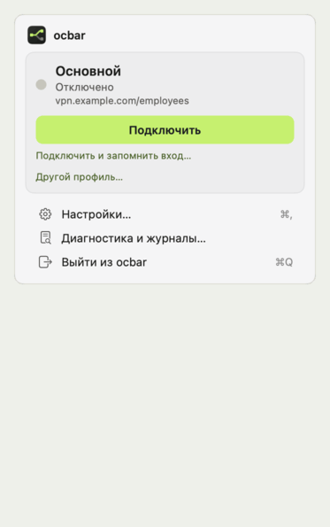
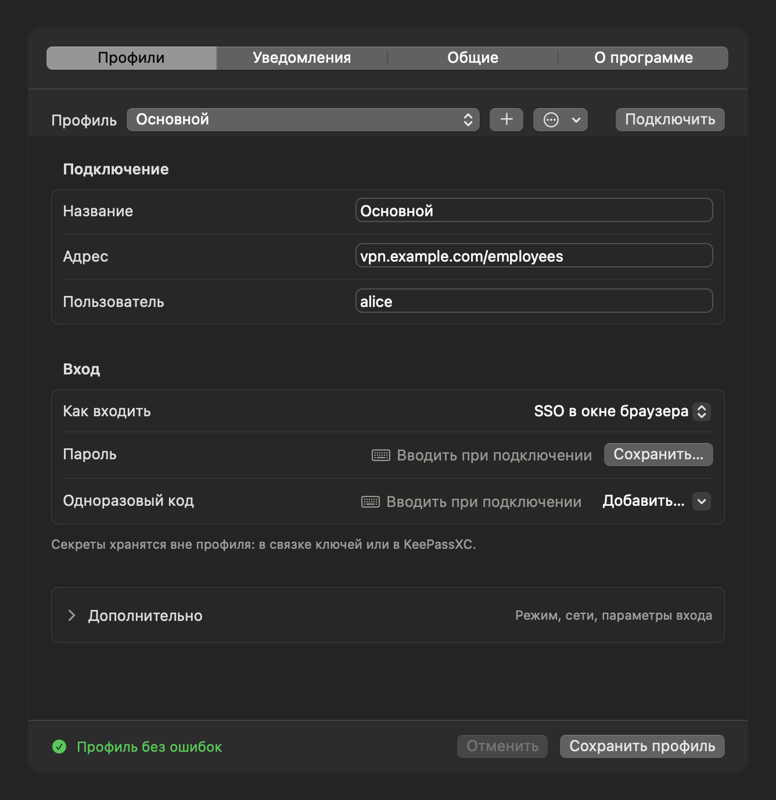

# OpenConnect for Mac

[Сайт](https://valeragin.github.io/openconnect-for-mac/ru/)

[English](README.md) · **Русский**

**Рабочий VPN в строке меню вашего Mac.**

Открытый клиент с поддержкой Cisco AnyConnect на основе
[OpenConnect](https://www.infradead.org/openconnect/). Войдите через SSO,
выберите сети для туннеля, ставьте подключение на паузу и возвращайтесь
из меню macOS. Супервизор восстанавливает соединение после сна и смены сети.

Бесплатно, под лицензией MIT. Homebrew собирает приложение на вашем Mac.
Нужны macOS 14.4+ и доступ к совместимому VPN-шлюзу: своих серверов OpenConnect for Mac
не предоставляет.



<sub>Настоящее меню на демо-профиле: подключение, выключение сети, пауза.</sub>

**Статус:** рабочий инструмент одного автора, которым он пользуется
каждый день. Вход через SSO, туннель, split DNS, маршруты и зоны на лету,
пауза, супервизор и приложение меню-бара проверены на реальном шлюзе
AnyConnect с провайдером входа Keycloak. Установка системного SOCKS в прокси-режиме
проверена только холостым прогоном. Приложение, окна входа и сообщения CLI
поддерживают русский и английский; язык выбирается в настройках. История версий —
[CHANGELOG.md](CHANGELOG.md), как поставить — [INSTALL.md](INSTALL.md).

Попробовали со своим шлюзом? [Расскажите, получилось ли](https://github.com/ValeraGin/openconnect-for-mac/issues/new?template=gateway_report.yml): короткий отчёт
о шлюзе и способе входа пополняет таблицу совместимости.

> Независимый проект, не официальный продукт OpenConnect. Не связан с проектом
> OpenConnect или Cisco. AnyConnect обозначает совместимость протокола.

Команда — `ocmac`, профиль — `.ocmac`. Для перехода с прежней установки:
`ocmac migrate`, затем `ocmac prepare && sudo ocmac install`. Исходные пользовательские файлы
сохраняются. Подготовка системной части остановит прежнюю VPN-сессию.

## Установка одной командой

В Терминале:

```bash
/bin/bash -c "$(curl -fsSL https://raw.githubusercontent.com/ValeraGin/openconnect-for-mac/main/install.sh)"
```

[Скрипт в репозитории](install.sh) предложит установить недостающие инструменты
Apple и Homebrew, поставит OpenConnect for Mac, системный помощник и запустит приложение.
Пароль администратора понадобится для системной части.
[Параметры и установка готового профиля](INSTALL.md#быстрая-установка-одной-командой).
Коллеге достаточно передать один `.ocmac` и
[ссылку на установку с готовым профилем](https://valeragin.github.io/openconnect-for-mac/ru/guide/#profile).
После установки откройте полученный `.ocmac` двойным щелчком, введите свой логин
и нажмите **Подключиться**. В новом окне не нужно заполнять сети и DNS.
Язык выбирается в **Настройки → Общие → Язык интерфейса**.


## Как это устроено

```
ocmac connect
  │
  ├─ ocmac-auth (Swift, WKWebView)        от пользователя
  │    init → окно SAML → cookie → auth-reply → session-token + server-cert-hash
  │
  └─ sudo -n ocmac-helper tunnel-start    root, NOPASSWD только на него
       ├─ openconnect --cookie-on-stdin --script "ocmac-helper vpnc" -b
       └─ vpnc: ifconfig utunN, наши маршруты, наши зоны /etc/resolver — и ничего больше

ocmac supervise (LaunchAgent)             от пользователя, раз в 5 с
       pid туннеля · kern.waketime · PrimaryInterface · маршруты на месте
```

Три слоя: аутентификатор, супервизор, UI. Привилегированный код — один файл
[libexec/ocmac-helper](libexec/ocmac-helper) с фиксированными подкомандами и
валидацией каждого аргумента, без постоянно работающего root-демона; модель
угроз — [SECURITY.md](SECURITY.md).

## Установка

Коротко (подробно и с объяснениями — [INSTALL.md](INSTALL.md)):

```bash
brew tap ValeraGin/openconnect-for-mac
brew trust ValeraGin/openconnect-for-mac            # tap не из homebrew-core: без этого brew откажется грузить формулу
brew install openconnect-for-mac                    # собирает из исходников у вас; --HEAD — с main
sudo ocmac install                    # один раз: хелпер, sudoers, агент

mkdir -p ~/.config/ocmac/profiles     # без профиля нечего подключать
cp "$(brew --prefix openconnect-for-mac)"/share/openconnect-for-mac/examples/example.ocmac ~/.config/ocmac/profiles/main.ocmac
$EDITOR ~/.config/ocmac/profiles/main.ocmac

ocmac secret set-password
ocmac connect --show
```

Из репозитория, без Homebrew:

```bash
brew install openconnect
git clone https://github.com/ValeraGin/openconnect-for-mac.git ~/Projects/openconnect-for-mac && cd ~/Projects/openconnect-for-mac
(cd auth && swift build -c release)   # Swift идёт с Command Line Tools
mkdir -p ~/.config/ocmac/profiles && cp etc/example.ocmac ~/.config/ocmac/profiles/main.ocmac
sudo ./bin/ocmac install
```

Обновление — `brew upgrade openconnect-for-mac`; если в выпуске изменился хелпер, после
него ещё раз `sudo ocmac install` (`ocmac doctor` скажет, что хелпер
отстал). Почему формула, а не
готовый бинарь: без Apple Developer ID собранное локально не получает
карантина, и Gatekeeper не мешает.

## Настройка

### Профиль одним файлом



По образцу конфигов WireGuard: один файл — одно подключение, целиком.
Кладётся в `~/.config/ocmac/profiles/<имя>.ocmac`, образец —
[etc/example.ocmac](etc/example.ocmac).

```ini
[Connection]
Name = Основной
Url  = vpn.example.com/employees
User = alice

[Routes]
10.0.0.0/8
172.16.0.0/12

[DNS]
example.com     = 10.0.0.1
corp.example.com = vpn

[Auth]
Totp         = keepassxc
KeepassEntry = Группа/Запись

[Health]
Check = wiki.example.com:443

[Autofill]
fill  username input[name=username]
fill  password input[name=password]
click button[type=submit]
```

Секретов в файле нет и быть не должно — только ссылки на хранилище, поэтому
такой профиль можно переслать коллеге — вместе с правилами заполнения формы
входа его портала (секция `[Autofill]`, пишется разметкой мышью: `ocmac
learn` или «Разметить…» в окне профиля; `ocmac rules show` покажет,
какие действуют). Форма в несколько окон — сначала пароль, потом код —
размечается по шагам: отметьте первое окно и нажмите «Пройти шаг →», OpenConnect for Mac
заполнит его вашими данными и перейдёт к следующему. Надёжно узнаваемое —
поле пароля, логин перед ним, поле со стандартным `autocomplete`, кнопку
формы — разметка отмечает сама; остаётся проверить. Кнопку экрана без
полей («Остаться в системе?») разметка записывает как «жать всегда», а ни
одна кнопка не нажимается, пока на странице видно пустое поле из правил:

```bash
ocmac import ~/Downloads/office.ocmac        # добавить
ocmac export main office.ocmac               # выгрузить
```

Экспорт работает и как перевод со старого формата: он соберёт профиль вместе
с сетями и зонами из общих конфигов в один самодостаточный файл.

### Переезд с Cisco Secure Client

```bash
ocmac import ~/Downloads/profile.xml      # список серверов из профиля AnyConnect
```

Переносятся только адреса серверов и группы: сети, зоны DNS и источники
секретов OpenConnect for Mac не угадывает — их вы задаёте сами, а правила формы входа
запишет первый вход с `--teach`.

### Первый вход: запомнить, как я вхожу

Размечать форму заранее не обязательно. Войдите по-настоящему, с галочкой
«Запомнить, как я вхожу» в окне входа:

```bash
ocmac connect --teach           # или в меню: «Подключить и запомнить вход…»
```

Вы вводите логин, пароль и код руками, OpenConnect for Mac запоминает, как устроена форма.
После входа он спросит, что сохранить: правила формы, пароль в связку ключей,
источник кода. Секрет TOTP принимается, только если даёт код, который вы
только что ввели. Секрет из Google Authenticator можно прочитать камерой Mac
прямо с экрана телефона: в приложении — «Перенос аккаунтов → Экспорт», в
окне OpenConnect for Mac — «Камерой…». Код по SMS отмечается как `Totp = sms`. Без вашего
выбора не сохраняется ничего.

### Прокси-режим

Тот же профиль может не поднимать интерфейс вовсе: `openconnect --script-tun`
отдаёт пакеты `ocproxy`, тот поднимает локальный SOCKS. Ни маршрутов, ни
`/etc/resolver`, ни хелпера — всё от пользователя.

```ini
[Connection]
Mode = proxy          # tunnel — по умолчанию

[Proxy]
Port        = 11080   # не 1080 и не 10808: их занимают другие
SystemProxy = off     # on — включить SOCKS всей системе через хелпер
```

```bash
brew install ocproxy                                   # не зависимость формулы: нужен только этому режиму
ocmac connect                                          # → SOCKS 127.0.0.1:11080
curl --socks5-hostname 127.0.0.1:11080 https://wiki.example.com
ALL_PROXY=socks5h://127.0.0.1:11080 git fetch
```

Имена внутренних хостов резолвит `ocproxy` по DNS шлюза (`socks5h`), поэтому
в системе ничего не меняется. Паузы в этом режиме нет — снимать нечего;
супервизор проверяет порт и при мёртвом SOCKS перезапускает процесс целиком.
`SystemProxy = on` ставит SOCKS на активный сетевой сервис и снимает при
отключении; если там уже включён чужой SOCKS, хелпер откажется и меню
покажет причину — чужие настройки не перезаписываются.

### Внешний скрипт HostScan

Если шлюз требует отчёт о состоянии устройства, укажите свой скрипт в профиле:

```ini
[Connection]
CsdWrapper = ~/vpn/csd-post.sh
```

Заготовка ставится вместе с ocmac:
`cp "$(brew --prefix openconnect-for-mac)"/share/openconnect-for-mac/examples/csd-wrapper.sh ~/vpn/csd-post.sh`.
Разрешите исполнение: `chmod u+x "$HOME/vpn/csd-post.sh"`. Пробелы в пути
поддерживаются; кавычки вокруг значения в профиле не нужны. Скрипт запускается
от пользователя до SSO с аргументами OpenConnect и переменными окружения
`CSD_HOSTNAME`, `CSD_TOKEN`, `CSD_SHA256`. Он сам отправляет подготовленный
отчёт; stdout — диагностика, а не отчёт для отправки клиентом. OpenConnect for Mac ждёт
результат проверки на шлюзе, затем продолжает SSO. Отсутствующий файл,
ошибка запуска или ненулевой код завершения скрипта останавливают вход.
Соответствие отчёта политике устройства определяет шлюз.

### CSD внутри профиля

Чтобы передать коллеге один `.ocmac`, в редакторе профиля раскройте
дополнительные настройки и нажмите **Встроить CSD-скрипт…**. Выбранный файл
сохранится в `[Connection] CsdScriptBase64`. Редактор и `ocmac export`
сохраняют его внутри профиля, без пути к файлу на вашей машине.

`CsdScriptBase64` содержит Base64 в одну строку. Поддерживаются скрипты UTF-8
до 256 КиБ с первой строкой `#!`; одновременно задавать `CsdWrapper` нельзя.
При импорте OpenConnect for Mac извлечёт скрипт в `~/.config/ocmac/csd/`, а `sudo ocmac install`
подготовит его копию для туннеля. Установщик делает оба шага сам:

```bash
/bin/bash -c "$(curl -fsSL https://raw.githubusercontent.com/ValeraGin/openconnect-for-mac/main/install.sh)" -- --profile ~/Downloads/office.ocmac
```

Параметр `--csd` для такого профиля не нужен. Чтение, проверка и импорт профиля
не запускают скрипт: он вызывается при подключении. После изменения встроенного
скрипта повторите `sudo ocmac install`, чтобы обновить системную копию.

### Старый формат

Прежняя раскладка продолжает работать: общий `profiles.conf` плюс отдельные
`networks.conf` и `zones.conf`.

Конфиги в `~/.config/ocmac/`, образцы в [etc/](etc/):

| Файл | Что |
|---|---|
| `profiles.conf` | профили: `url`, `user`, `auth = sso\|password`, `keychain_service`, `healthcheck` |
| `networks.conf` | CIDR в туннель, по одному на строку |
| `zones.conf` | `<зона> <DNS\|vpn> [порт]` — `vpn` означает DNS, который прислал шлюз |
| `autofill.rules` | правила заполнения формы IdP, читаются при каждом запуске; у профиля-файла с секцией `[Autofill]` не читаются |

Полезные ключи профиля: `healthcheck` — что проверить после подключения
(URL, «хост:порт» или имя); `notifications = off` в шапке файла выключает
уведомления системы.

Секреты — в Keychain, в аргументы не попадают. Проще всего — в приложении:
«Настройки → Профили → Вход». У пароля кнопка «Сохранить…», у кода —
«Добавить…»: QR с экрана (выделить рамкой), камерой или ссылкой `otpauth://`.
После добавления рядом виден текущий код — сверьте его с приложением-аутентификатором.
То же из терминала:

```bash
ocmac secret set-password       # спросит security, не ocmac
ocmac secret add-totp <профиль> --screen    # QR с экрана: выделить рамкой
ocmac secret add-totp <профиль> --camera    # QR камерой
echo 'otpauth://totp/…' | ocmac secret add-totp <профиль> --stdin
ocmac secret status             # что есть в связке и включён ли автоввод
```

Секрет TOTP удобнее занести из QR-кода — понимается и обычный `otpauth://`,
и экспорт Google Authenticator. Секрет идёт прямо в Keychain, на экран не
попадает:

```bash
ocmac secret import-qr ~/Downloads/qr.png --list          # что внутри
ocmac secret import-qr ~/Downloads/qr.png --select <часть-имени>   # занести нужное
```

Экспорт почти всегда содержит несколько записей, поэтому без `--select`
импорт откажется работать: занести чужой секрет и получить блокировку
учётной записи на неверных кодах — слишком дорогая ошибка.

Пароль и одноразовый код берутся из одного из нескольких источников — это
одна и та же схема для обоих. Для KeePassXC в профиле:

```ini
password = keepassxc          # auto (по умолчанию) | keychain | keepassxc | command | ask
totp = keepassxc              # auto (по умолчанию) | keychain | keepassxc | command | sms | off
keepass_entry = Группа/Запись
keepass_db = ~/путь/база.kdbx
keepass_keychain_service = keepassxc-docs
```

Ни пароль, ни секрет при этом не копируются: `keepassxc-cli` читает базу
напрямую, значения уходят в окружение подпроцесса и нигде не печатаются.
`auto` — «разберись сам»: команда, если задана; иначе связка ключей (для
пароля — если он там есть); иначе база, если указана запись.
`password = ask` означает «вводит человек», `totp = sms` — код приходит по
SMS и вводится руками, `totp = off` — автоввод кода выключен; во всех трёх
случаях молчаливого переподключения не будет.

Мастер-пароль базы берётся из Keychain по имени сервиса и в аргументы не
попадает; `keepassxc-cli` читает файл напрямую, разблокировать окно
KeePassXC не нужно.

База — лишь один из источников. Любой другой подключается командой:

```ini
totp = command
totp_command = op item get VPN --otp

password = command
password_command = op item get VPN --fields password
```

Если источник недоступен, вход не ломается — код вводит человек, причина
пишется в журнал.

### Своя форма входа

Встроенные правила автозаполнения покрывают типовые формы (Keycloak,
Microsoft). У других компаний форма своя — покажите её программе мышью:

```bash
ocmac learn                 # откроется форма входа вашего портала
```

Щёлкайте по полю логина, полю пароля, полю кода и по кнопке отправки: вид
элемента определяется сам (можно поправить, выбрав его слева). Щелчок в
режиме разметки до страницы не доходит — кнопка «Войти» от него не
сработает; чтобы пройти форму дальше, снимите галочку «Отмечать элементы»
или просто печатайте — отмеченное поле получает фокус сразу.

По кнопке «Готово» правила ложатся в сам профиль — секцию `[Autofill]`
файла `~/.config/ocmac/profiles/<имя>.ocmac`, а прошлая версия профиля
остаётся рядом с суффиксом `.bak`. В общий файл
`~/.config/ocmac/autofill.rules` (или в файл из ключа `Rules`) они пишутся,
только если профиль указывает на файл ключом `Rules`, если профиль старого
формата (`profiles.conf`) или если задан `ocmac learn --out <файл>`. Закрытое
окно без «Готово» ничего не пишет. То же самое есть в приложении:
«Настройки → Профили → Подключение → Разметить…».

```bash
ocmac rules show <профиль>              # какие правила действуют и откуда
ocmac rules import <файл> <профиль>     # положить файл правил в [Autofill]
ocmac rules clear <профиль>             # убрать секцию — снова встроенные или общий файл
```

Формат правил простой и правится руками — один и тот же в секции
`[Autofill]` ([etc/example.ocmac](etc/example.ocmac)) и в файле
([etc/autofill.rules.example](etc/autofill.rules.example)).

### Автоподключение и вход

Супервизор поднимает туннель **молча**: окно входа не появляется поверх
работы. Если сохранённой сессии хватило, подключение проходит само. Если
нет, приходит уведомление, автопопытки останавливаются, и решение за вами —
`ocmac connect`.

### Подключение через внешний прокси

В `[Connection]` можно задать `UpstreamProxy = http://127.0.0.1:10808`
или `socks5://127.0.0.1:10808`. Это путь до VPN-шлюза: парольный вход,
SSO и VPN-туннель используют один прокси. Работает с `Mode = tunnel` и
`Mode = proxy`; секция `[Proxy]` по-прежнему задаёт локальный SOCKS для
приложений после подключения к VPN.

Поддерживаются HTTP CONNECT и SOCKS5 без авторизации, с обязательным портом
1–65535 и DNS-именем либо IPv4-адресом. Пароли, пути и IPv6-литералы в этом
поле не принимаются. Нужен helper 0.8.3 или новее (`sudo ocmac install`);
прокси действует для парольного входа, SSO и обучения.
При заданном прокси DTLS принудительно выключен: транспорт идёт по TCP.
При отказе прокси прямого переподключения к внешнему шлюзу нет.
WebKit/URLSession исключают loopback-адреса из проксирования — для локальных
шлюзов SSO эта настройка не предназначена.

CSD-обёртка получает `http_proxy`, `https_proxy`, `all_proxy` и варианты
в верхнем регистре; `NO_PROXY` очищен. Пользовательский скрипт должен
учитывать эти переменные: OpenConnect for Mac не перехватывает его произвольные сокеты.
Настройка не запускает сам прокси; его сервис должен работать заранее.
Пустое поле сохраняет прежнее поведение подключения.

## Команды

```
ocmac connect [профиль] [--show] [--teach] [-v]
                                      SSO и туннель; окно покажется, если за 2 с не прошло молча;
                                      --teach — войти руками и запомнить форму, пароль, код
ocmac disconnect
ocmac logout                          выйти совсем: отключиться и забыть сессии входа (проверки)
ocmac status [--short|--json]                --short — машинный вид для меню
ocmac profiles | import <файл> | export <профиль> [файл]
ocmac profiles order [имя…]           порядок профилей в меню; без имён — текущий
ocmac routes on|off|toggle <CIDR>     сети на живом туннеле; apply | clear | status
ocmac dns on|off|toggle <зона>        зоны /etc/resolver; apply | clear | status
ocmac autoconnect [manual|resume|always <профиль>]   кто поднимает туннель
ocmac report [файл] [--raw]           отчёт для разбора: адреса и логины скрыты
ocmac logs [-f] [-n N] [источник…]    все журналы одной лентой по времени; -f — следить
ocmac profile-check <файл>            примет ли клиент такой профиль (этим редактор проверяет форму)
ocmac state [--json]                  рабочее состояние одним снимком: профиль, автоподключение, доступ, флаги
ocmac pause | resume | toggle         «как будто выключен»: маршруты и зоны сняты,
                                      туннель и вход живы, возврат мгновенный
ocmac secret set-password|set-totp|status|code [профиль]
ocmac secret import-qr <файл> [--list] [--select ИМЯ] [профиль]
ocmac learn [профиль] [--probe] [--out <файл>]   разметить форму входа
ocmac rules show|import <файл>|clear [профиль]  правила в [Autofill] профиля
ocmac app start|stop|status           приложение меню-бара; autostart on|off; devmode on|off
ocmac supervisor status|start|stop|restart       агент супервизора
ocmac version [--all]                 версия; --all — версии и пути всех частей
ocmac doctor                          диагностика, ничего не меняет
ocmac selftest                        самопроверка на подставленных конфигах
ocmac cleanup                         мусор после падения: наши зоны, маршруты, SOCKS
sudo ocmac install [--trust] | uninstall
--dry-run                             печатать привилегированные команды вместо выполнения
```

Аутентификатор отдельно — удобно для диагностики шлюза без учётных данных:

```bash
auth/.build/release/ocmac-auth --probe --url vpn.example.com/group
auth/.build/release/ocmac-auth --selftest        # TOTP по RFC 6238, разбор XML
auth/.build/release/ocmac-auth --dump-script     # JS автозаполнения по правилам
```

## Самопроверки

Ничего не трогают и не требуют ни сети, ни привилегий: конфиги подставные,
состояние и журнал уводятся во временный каталог, вместо хелпера — заглушка. Каждая печатает итог с числом проверок.

```bash
ocmac selftest                      # разбор профиля, сети и зоны, отказы, уборка только своего, уведомления
ocmac-app --selftest                # разбор и запись профиля (сверка с ocmac export), проверки, опрос, токен
ocmac-auth --selftest               # TOTP по RFC 6238, разбор XML, где заполнять форму, лимиты, cookie
ocmac-auth --learn-selftest         # разметка и запись входа на странице-образце
tools/helper-selftest.sh            # хелпер целиком на --dry-run с заглушками (только из репозитория)
```

Отдельно, уже на живом подключении (меняет состояние и возвращает обратно):

```bash
ocmac-app --selftest --live-actions  # сеть, зона, пауза и возобновление
```

## Песочница интерфейса

Отдельная страница, где меню смотрится во всех состояниях сразу: подключено,
пауза, потеря связи, ожидание входа, отключено. Переключается тема, график
живой.

```bash
ocmac ui-lab            # на данных-образце
ocmac ui-lab --live     # подложить снимок реального состояния
```

Снимок кладётся рядом со страницей и в репозиторий не попадает: в нём
рабочие адреса. Страница самодостаточна — ни одной внешней загрузки,
открывается прямо из файла.

## Меню-бар

Приложение [app/](app/) — SwiftUI, меню `NSHostingMenu`, macOS 14.4+. Читает
`ocmac status --json`, действия делает вызовами `ocmac`; собственных
привилегий у него нет.

```bash
ocmac app start                 # запустить
ocmac app autostart on          # запускать при входе в систему
(cd app && ./make-app.sh)       # собрать бандл из репозитория
```

Меню — обычное меню macOS. Первой строкой — «Подключить VPN» или «Отключить
VPN». Ниже профили; у подключённого — состояние и время сессии, во время
подключения — шаг («Вхожу · 2/4»); щелчок по другому профилю подключает его.
Значок в строке меню во время подключения заполняется по шагам. «Сети в
туннеле» и «DNS-зоны» — подменю с галочками, щелчок переключает. Внизу —
«Приостановить» (⌥⌘P) или «Возобновить», «Настройки… ⌘,», «Диагностика и
журналы…», «Выйти из OpenConnect for Mac». Меню, открытое с зажатой ⌥, показывает «Сведения
о соединении»: адрес в туннеле, шлюз, MTU, резолверы, скорость, суммарный
трафик, задержку, проверку доступа. В прокси-режиме вместо сетей — адрес SOCKS:
щелчок копирует его. Предупреждения — строками со значком: «Мак просыпался
после подключения», «Уведомления выключены — Разрешить…», ошибка — щелчок
открывает журнал. Вход, который ждёт человека, — строками «Войти…», «Войти и
запомнить вход…», «Не подключаться».

Первый запуск ведёт мастер: системная часть, профиль, первый вход
(«Настроить OpenConnect for Mac…» в меню, пока профилей нет).

Отдельными окнами — настройки в стиле Системных настроек (разделы слева; у профиля части «Подключение / Режим / Сети и DNS») и
диагностика (`ocmac doctor` с кнопкой «повторить», уборкой и журналами).
Порядок профилей — перетаскиванием в списке окна профиля (или `ocmac
profiles order`); тот же порядок в меню. В окне профиля наверху то, что нужно для входа: название, адрес,
пользователь, откуда пароль и код и есть ли они в связке ключей; форма
входа — итогом («2 окна: логин+пароль → код») и кнопкой «Разметить…»;
сети, зоны и всё редкое — в свёрнутых «Сети и DNS» и «Дополнительно».
Поля проверяются при вводе.

Состояния различаются целиком, а не одной строкой: подключено, пауза,
восстановление связи, ожидание входа, отключено, чужой туннель, клиент не
найден. Посмотреть их все разом, не рвя связь:

```bash
app/.build/ocmac.app/Contents/MacOS/ocmac-app --stage         # витрина состояний
app/.build/ocmac.app/Contents/MacOS/ocmac-app --selftest      # разбор, запись профиля, правила
```

[swiftbar/ocmac.5s.sh](swiftbar/ocmac.5s.sh) — плагин [SwiftBar](https://github.com/swiftbar/SwiftBar):
статус, профили, тоглы маршрутов и зон, предупреждение «мак просыпался после
подключения». Остаётся запасным вариантом и проверяется без SwiftBar — это
просто stdout.

## Что защищено

- **чужие зоны в `/etc/resolver` не трогаются** — хелпер помнит только свои
  (манифест), чужой файл пропускает и в манифест не берёт;
- **чужой openconnect не трогается** — `cleanup` и `disconnect` гасят только
  свои сессии (запущенные хелпером, с его `--pid-file`), а `disconnect` не
  погасит чужой `utun`. Своя лишняя сессия — та, что не записана в pidfile, —
  видна в `ocmac status` и `ocmac doctor` и гасится `ocmac cleanup`; её
  vpnc-script состояние текущей сессии не трогает;
- **root исполняет копию из своего каталога**: `openconnect` копируется в
  `/usr/local/libexec/ocmac/` и сверяется по sha256 вместе с библиотеками,
  csd-wrapper берётся только по имени из root-каталога, vpnc-script — сам
  хелпер. Оговорка: библиотеки остаются в каталоге Homebrew, доступном
  пользователю на запись, поэтому проверка ловит случайное расхождение после
  обновления, но не целенаправленную подмену;
- **cookie сессии и пароли** идут через stdin и окружение, в `ps` их нет.

## Пауза вместо отключения

Отключение и повторный вход стоят второго фактора и новой сессии на шлюзе.
Когда VPN нужно просто убрать с дороги — посмотреть на сайт снаружи, сходить
в домашнюю сеть, не гонять трафик через корпоративный канал — есть пауза:

```bash
ocmac pause     # маршруты и зоны сняты, туннель и SSO-сессия живы
ocmac resume    # вернуть, мгновенно и без входа
```

Пауза переживает обрыв связи: если туннель переподнимется сам, маршруты не
вернутся, пока не скажете `resume`. Новое подключение (`connect`) всегда
начинается без паузы.

## Ограничения

- парольные группы (логин + OTP из SMS, `auth = password`): пароль `ocmac`
  подставит сам, код из SMS вводит человек в окне «Код из SMS», поэтому молча
  переподключиться такой профиль не может — автоподключение скажет «нужен вход»;
- «всё в туннель» настраивается сетями `0.0.0.0/1` и `128.0.0.0/1` в конфиге, но шлюз при этом может не выпускать в интернет — проверено;
- IPv6 в туннеле не обрабатывается (адрес ставится, маршруты — нет);
- без Apple Developer ID: только сборка из исходников, поэтому Homebrew formula,
  а не cask.

## Документация

| Файл | О чём |
|---|---|
| [INSTALL.md](INSTALL.md) | Установка с нуля, настройка, перенос на другую машину, удаление |
| [TROUBLESHOOTING.md](TROUBLESHOOTING.md) | Что делать, когда не работает — по реальным отказам |
| [SECURITY.md](SECURITY.md) | Модель угроз и как сообщить об уязвимости |
| [CHANGELOG.md](CHANGELOG.md) | История версий |

## Автор

**ValeraGin** — Валерий Игнаткович,
[github.com/ValeraGin](https://github.com/ValeraGin).
Лицензия MIT, см. [LICENSE](LICENSE).
